# Thiết kế luồng nghiệp vụ — SanBong.vn

> Nguồn: `PRD.docx` (Đặt sân bóng đá trực tuyến thông minh). File này chuyển toàn bộ
> Happy Case + Edge Case của PRD thành sơ đồ luồng (flowchart) cú pháp **Mermaid**, để
> AI/dev đọc thiết kế trước khi code thay vì phải mở lại file Word.
>
> Khi implement một chức năng, đọc đúng mục tương ứng bên dưới trước, đối chiếu với
> module backend đang có (`backend/src/modules/*`) rồi mới viết code.

## Mục lục

- [1. Người chơi / Đội bóng](#1-người-chơi--đội-bóng)
  - [1.1 Đăng ký / Đăng nhập & cập nhật hồ sơ](#11-đăng-ký--đăng-nhập--cập-nhật-hồ-sơ) — module `auth`
  - [1.2 Tìm kiếm & gợi ý sân](#12-tìm-kiếm--gợi-ý-sân) — module `venues`
  - [1.3 Đặt sân lẻ real-time](#13-đặt-sân-lẻ-real-time) — module `bookings`, `payments`
  - [1.4 Đặt sân định kỳ](#14-đặt-sân-định-kỳ) — module `bookings`
  - [1.5 Ghép đối giao hữu (Team vs Team)](#15-ghép-đối-giao-hữu-team-vs-team) — module `community`
  - [1.6 Ghép người chơi lẻ (Team vs Freelance)](#16-ghép-người-chơi-lẻ-team-vs-freelance) — module `community`
  - [1.7 Quản lý lịch & đánh giá](#17-quản-lý-lịch--đánh-giá) — module `bookings`
- [2. Chủ sân (Owner)](#2-chủ-sân-owner)
  - [2.1 Đăng ký cụm sân](#21-đăng-ký-cụm-sân) — module `venues`
  - [2.2 Khóa sân nhanh (1-tap Lock)](#22-khóa-sân-nhanh-1-tap-lock) — module `bookings`
  - [2.3 Dynamic Pricing & Flash Sale](#23-dynamic-pricing--flash-sale) — module `venues`
  - [2.4 Dashboard báo cáo chủ sân](#24-dashboard-báo-cáo-chủ-sân)
- [3. Admin](#3-admin)
  - [3.1 Duyệt cụm sân & quản lý tài khoản](#31-duyệt-cụm-sân--quản-lý-tài-khoản)
  - [3.2 Xử lý khiếu nại](#32-xử-lý-khiếu-nại)
  - [3.3 Báo cáo toàn hệ thống](#33-báo-cáo-toàn-hệ-thống)

---

## 1. Người chơi / Đội bóng

### 1.1 Đăng ký / Đăng nhập & cập nhật hồ sơ

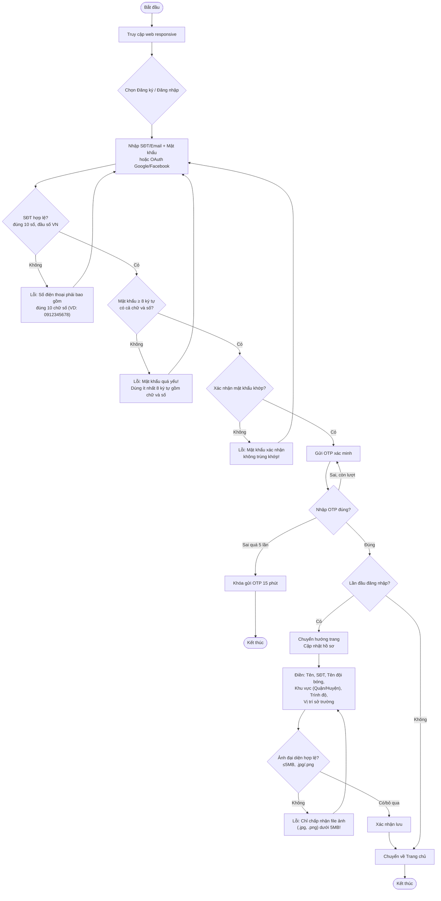

### 1.2 Tìm kiếm & gợi ý sân

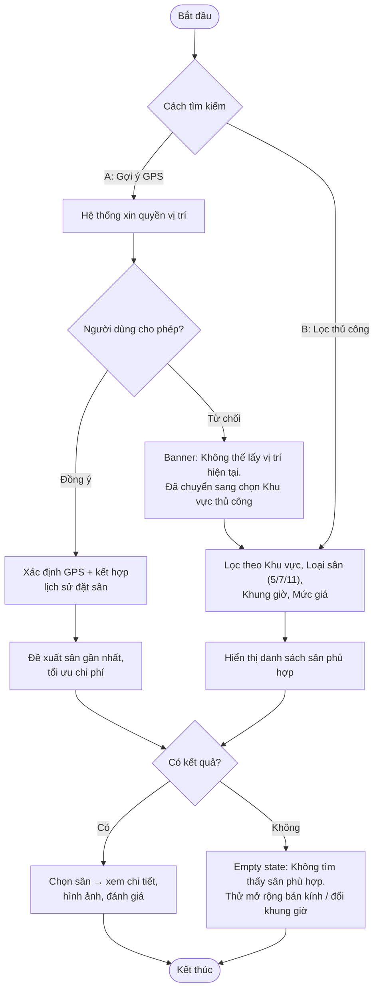

### 1.3 Đặt sân lẻ real-time

**Bước 1 — Chọn giờ & giữ chỗ**

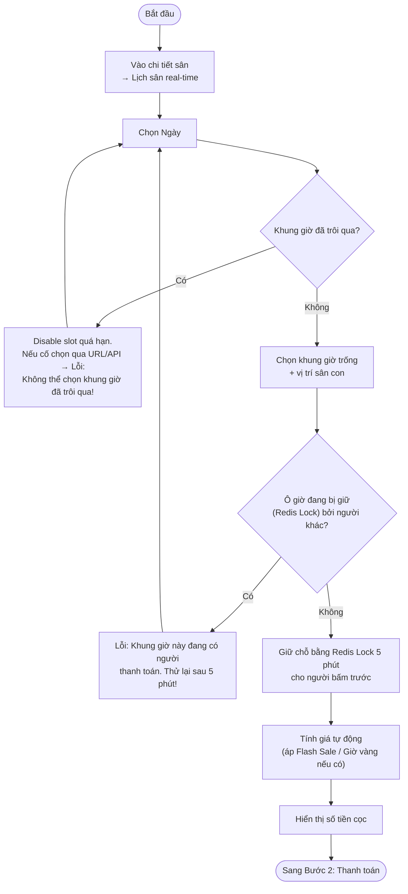

**Bước 2 — Thanh toán & xác nhận**

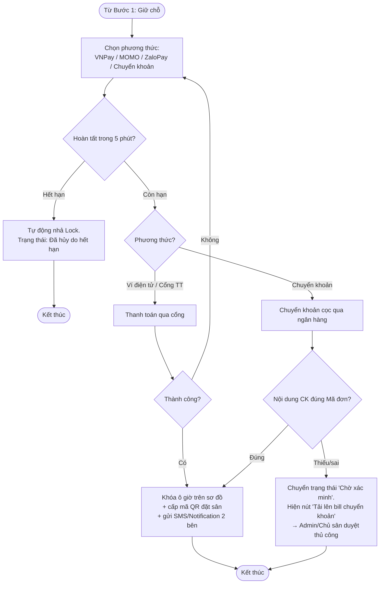

### 1.4 Đặt sân định kỳ

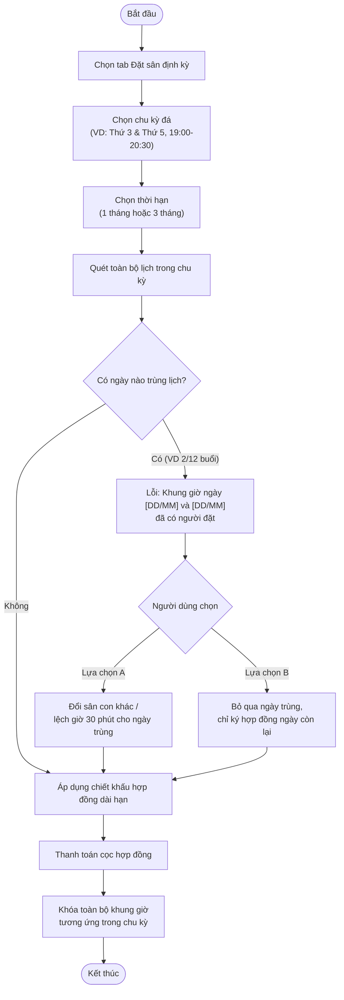

### 1.5 Ghép đối giao hữu (Team vs Team)

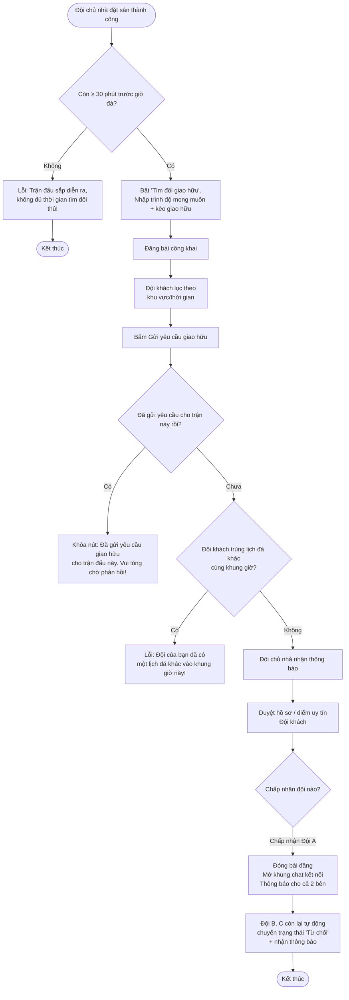

### 1.6 Ghép người chơi lẻ (Team vs Freelance)

**1.6.1 — Đội thiếu người đăng tin tuyển**

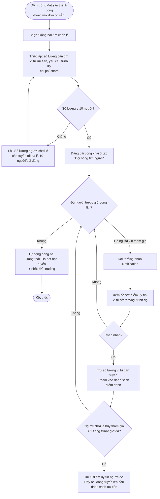

**1.6.2 — Người chơi lẻ, Cách 1: chủ động tìm đội**

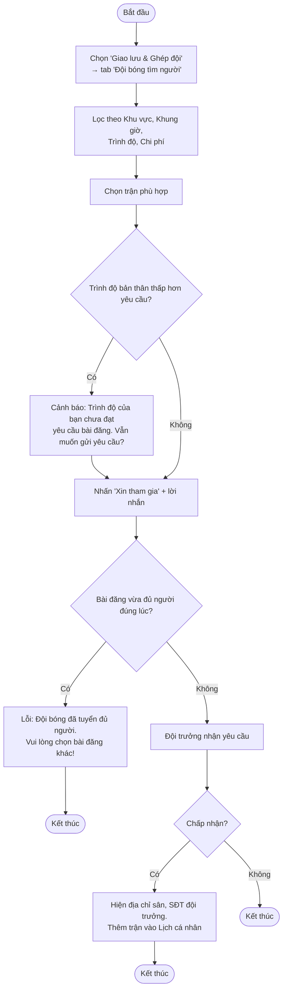

**1.6.2 — Cách 2: đăng tin, thụ động chờ đội mời**

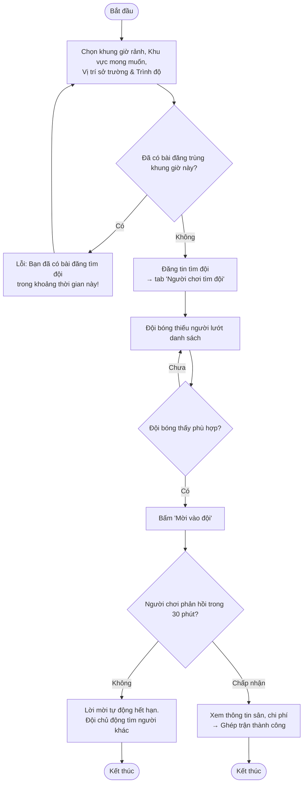

### 1.7 Quản lý lịch & đánh giá

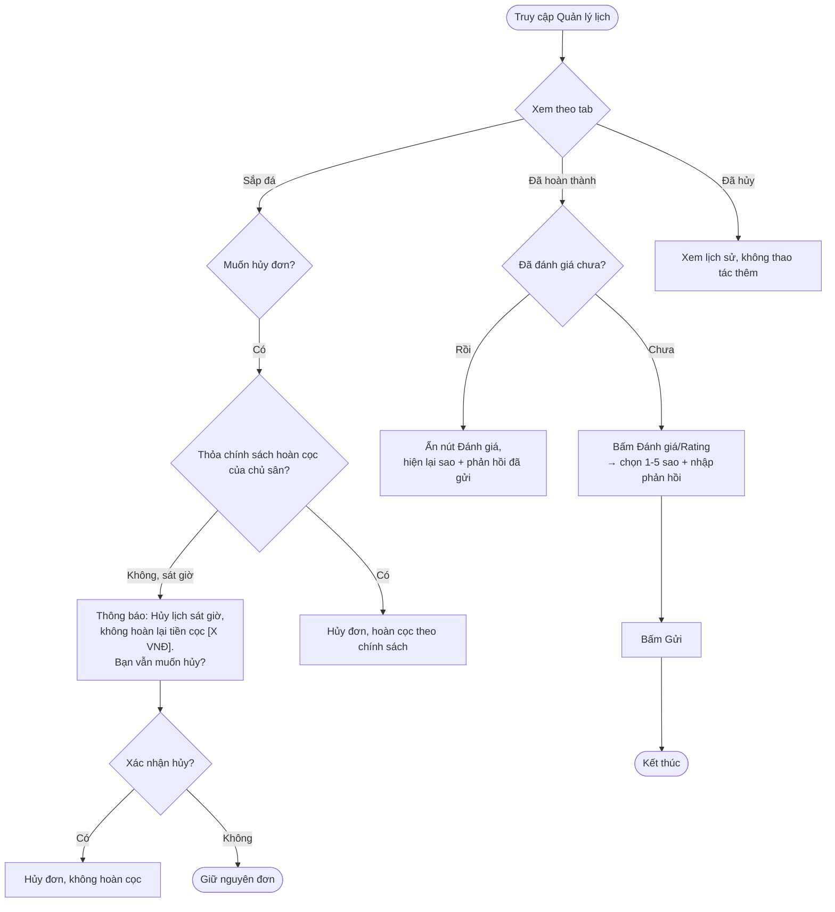

---

## 2. Chủ sân (Owner)

### 2.1 Đăng ký cụm sân

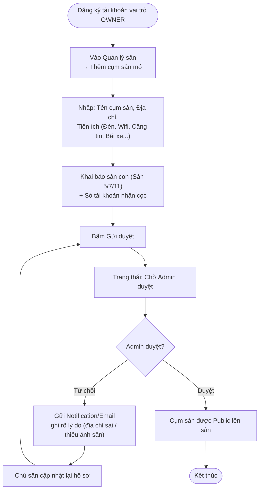

### 2.2 Khóa sân nhanh (1-tap Lock)

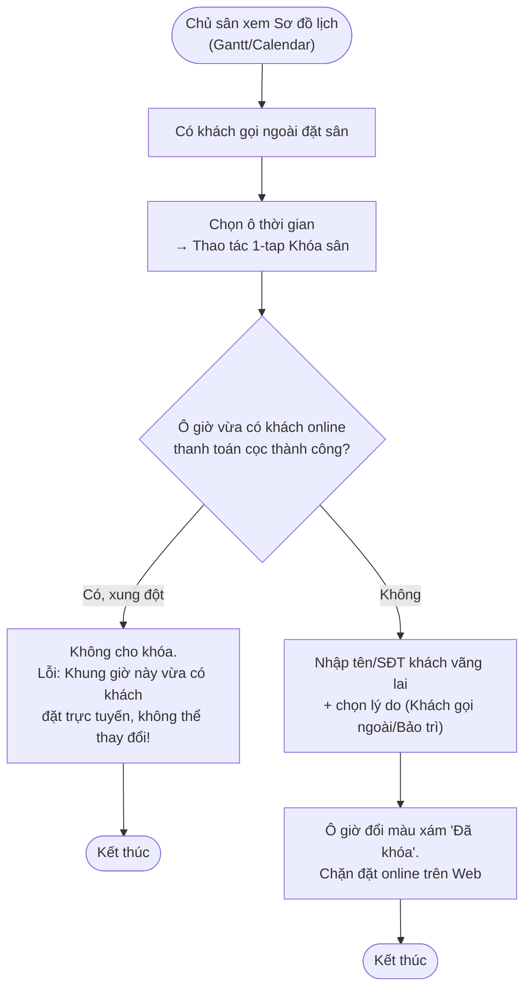

### 2.3 Dynamic Pricing & Flash Sale

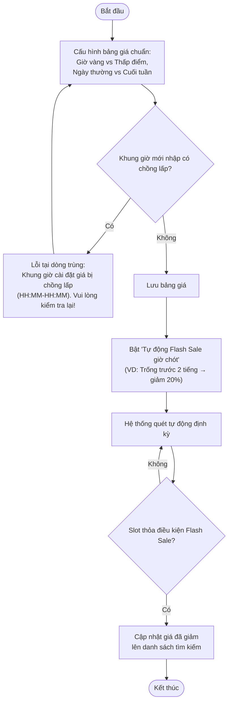

### 2.4 Dashboard báo cáo chủ sân

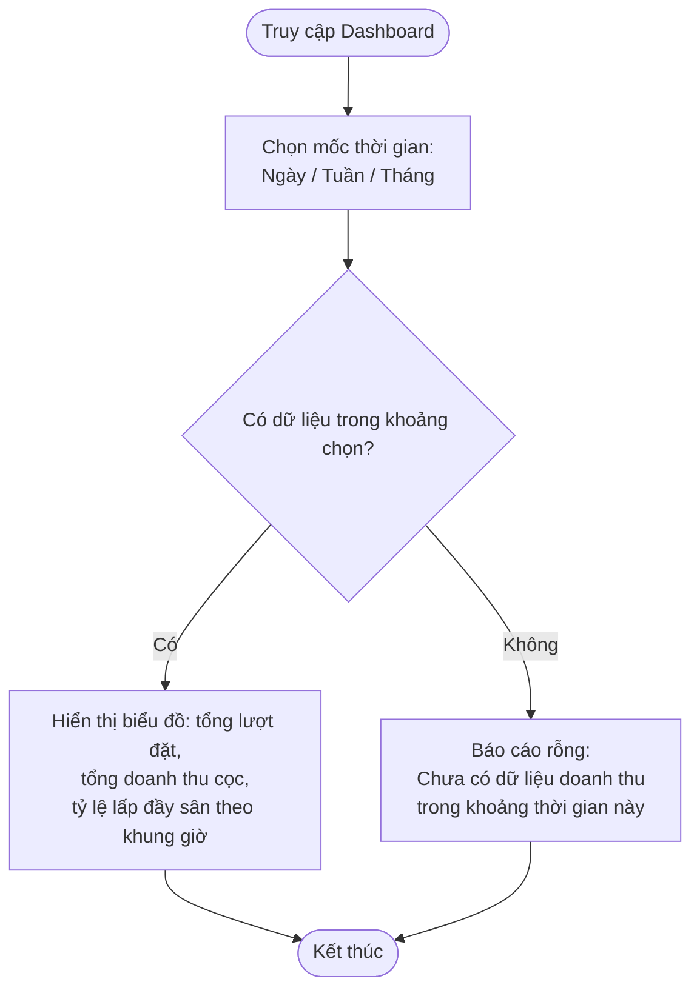

---

## 3. Admin

### 3.1 Duyệt cụm sân & quản lý tài khoản

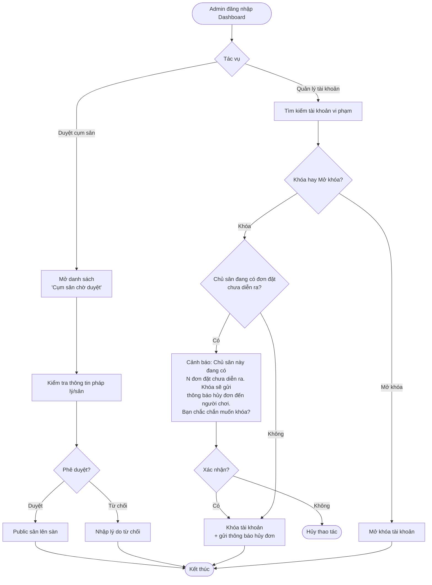

### 3.2 Xử lý khiếu nại

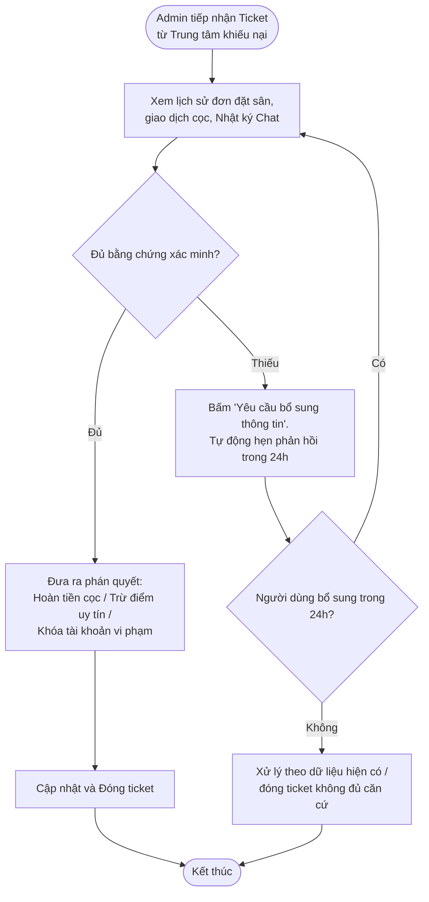

### 3.3 Báo cáo toàn hệ thống

```mermaid
flowchart TD
    A([Admin truy cập Báo cáo hệ thống]) --> B[Chọn bộ lọc mốc thời gian]
    B --> C{Khoảng dữ liệu lớn (nhiều năm)?}
    C -->|Có| D[Xử lý ngầm - background job]
    D --> E["Gửi link tải file Excel<br/>qua Email Admin khi hoàn tất"]
    C -->|Không| F["Xuất báo cáo trực tiếp:<br/>tổng lượt đặt toàn sàn, tổng doanh thu,<br/>tỷ lệ lấp đầy sân trung bình"]
    F --> Z([Kết thúc])
    E --> Z
```
